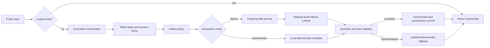

# Mirage artifact-generation architecture

Reviewed 2026-09-27. This is a focused companion to the [system architecture](RESEARCH_ARCHITECTURE.md). Requirements and acceptance criteria remain authoritative in the [Research MVP](RESEARCH_MVP.md) and [verification plan](VERIFICATION_PLAN.md).

## Current path

Approved manifest files can be deterministic or AI-backed. On a missing content hash, FUSE calls a session-scoped `GenerationOrchestrator`. The default `deterministic` mode renders or validates a local template and never constructs an inference runtime. Optional `ollama` mode builds prompts from trusted profile facts, validates model output and falls back explicitly. Both modes deduplicate local work with a future per inode, use a cross-process Redis lease and commit only if the lease and inode revision still match. Participant state remains authoritative.

The first read waits at most approximately ten seconds for its submitted future; a job may continue within its separately bounded generation budget. The Redis lease is currently 120 seconds. Model requests are run in killable child processes to bound blocked DNS, headers, and streams. These mechanisms require integration tests; their presence is not an availability guarantee.

`config/ubuntu.yaml` defines profile facts. `config/generation_policy.yaml` selects file class, category, model and constraints. The policy currently includes intentionally degraded categories such as empty, broken, or corrupted. Those require explicitly labeled experiments and cannot count as valid required configuration in the primary comparison.

Prepared artifacts can be generated before sessions and installed into new namespaces only when the versioned bundle identity matches the profile, policy/model routing and hashes of the prompt, validator and orchestration components. Preparation rejects fallback-sourced results, resolves mutable local model tags to immutable Ollama digests and stores those digests with artifact provenance. Formal evaluation must still freeze the complete source revision, dependency/model inventory and preparation output; the bundle key is an invalidation mechanism, not a complete experiment manifest.

## Boundaries and known gaps

- Optional inference is local Ollama; cloud provider claims are obsolete.
- Base Compose is deterministic and independent of Ollama. The `inference` profile plus `CHRONOS_INFERENCE_MODE=ollama` selects the separate experimental treatment.
- Generation receives trusted rebuilt profile state, not attacker command history. The `machine_state` argument passed into the public call is currently not used by resolution.
- Provenance records source, model, class, prompt version, generation time and validation status. Release evidence needs stronger build/model/config identifiers outside the per-blob record.
- Fallback is useful content availability, not an AI success. Empty or intentionally degraded policy output is a treatment choice, not a system failure.
- Generated content cannot mutate existence, permissions, directory structure or command outcomes.
- Model output validation reduces known contradictions; it cannot prove general semantic coherence.

Attacker expertise does not control model routing. Session summaries expose observable rule-linked patterns, not expertise estimates.
