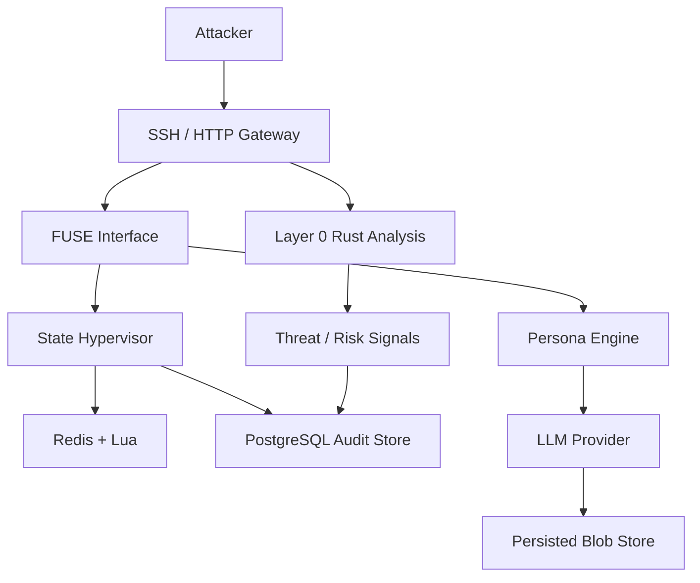

# Mirage Architecture

> Repository codename: **Apate**
>
> Product name: **Mirage**
>
> Framework name: **Chronos**

Chronos is the implementation framework behind Mirage. It is built to keep attacker interaction coherent over time, even when the interaction becomes messy, concurrent, or suspicious in exactly the way real attackers prefer.

The architecture follows one rule above all others: state must stay truthful. LLMs may help with content, but they never own the truth of the filesystem.

## System Layers

1. Gateway layer
   - SSH and HTTP entry points accept attacker traffic.
   - Requests are logged and passed into the analysis pipeline.

2. Interface layer
   - The FUSE filesystem turns system calls into filesystem operations.
   - Standard tools such as `ls`, `cat`, `rm`, and `vi` work without special handling.

3. Core layer
   - The state hypervisor owns inode allocation, path resolution, and mutation logic.
   - Redis stores live state and executes atomic Lua scripts.
   - PostgreSQL stores audit and session history.

4. Intelligence layer
   - Persona generation fills in missing file content on demand.
   - The generated output is persisted so later reads stay consistent.
   - The LLM is used as a content source, not a state engine.

5. Analysis layer
   - Command analysis classifies attack techniques.
   - Threat signatures and skill profiling feed session scoring.
   - Event processing streams observations for monitoring and correlation.

6. Layer 0
   - A Rust subsystem handles early protocol analysis and filtering.
   - It gives the Python layers less noise to sort through, which is a kindness worth preserving.

## High-Level Flow

## State Model

Chronos simulates a real filesystem, so hierarchy is encoded explicitly.

- `fs:inode:<id>` stores inode metadata.
- `fs:dir:<id>` stores directory entries.
- `fs:blob:<hash>` stores file content.
- `fs:next_inode` allocates identifiers atomically.

This separation lets the system resolve paths, persist mutations, and reuse generated content without asking the LLM to remember what it never owned.

## Design Principles

- Prefer deterministic state transitions over clever reconstruction.
- Keep content generation lazy and cached.
- Make every mutation auditable.
- Fail visibly, not theatrically.
- Preserve realism where attackers check it: continuity, timing, and filesystem truth.

## Related Documents

- [Problem Validation Analysis](../PROBLEM_VALIDATION_ANALYSIS.md)
- [Developer Onboarding](ONBOARDING.md)
- [How To Use Chronos](HOW_TO.md)
- [Roadmap](ROADMAP.md)
- [Current Status](STATUS.md)
