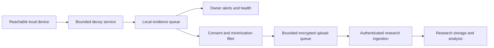

# Mirage Home: future product design

Version 1.0 — 2026-09-25. Future requirements, not a deployment claim. Research MVP is the first product; see [plan](PLAN_INDEX.md).

## Purpose and honest promise

Mirage Home is a household decoy sensor that alerts an owner to suspicious interaction with the decoy and can contribute selected observations to research with explicit consent. It complements existing security controls. It cannot claim the entire home is safe, identify every compromised device, prevent phishing, or observe attacks directed exclusively elsewhere.

A LAN decoy behind a router commonly observes reachable local traffic rather than unsolicited internet traffic blocked upstream. Guest-network isolation and network placement affect reachability. Wider visibility through router integration or mirrored traffic is a different product capability. Do not automatically enable port forwarding or UPnP to attract activity.

## Users and workflow

The owner needs simple setup, a clear health state, understandable alerts and control over sharing. A researcher needs provenance, selection context and trustworthy event processing. These needs require different interfaces and retention policies.

Owner flow: install/pair → verify network placement and sensor health → choose sharing (off by default) → receive an explained decoy-interaction alert → inspect available evidence and suggested checks → dismiss/annotate → optionally share a previewed report → pause, export or delete local data.

Example alert: “A device at this local address attempted to use the decoy SSH service at 14:20. The sensor recorded three command attempts. Check whether this was your own scan or maintenance tool.” Avoid “Your home was hacked,” inferred expertise and unsupported identity claims.

## Proposed architecture

Share schema, rule definitions, export tooling and selected emulator components with Research. Do not require household PostgreSQL, Grafana or a local language model. Evaluate a local bounded store and lightweight runtime. FUSE and the privileged research core are not assumed suitable for a home appliance; prototype a reduced runtime and measure resource use before selecting hardware.

There is no required inbound research-management channel. Any future remote management must have separately scoped authorization, authentication, update and audit controls. Local alerts must remain useful during internet or research-service outages.

## Threat and trust boundaries

Untrusted LAN clients can flood the decoy, submit misleading content and attempt escape. A compromised sensor can send misleading research data. The research service must also protect households against unauthorized access and tenant mixing. Authentication establishes a sensor source, not factual accuracy of every submitted field.

Minimize service privileges, isolate the decoy from owner data/credentials, bound workload and queues, and deny unnecessary outbound behavior. The appliance must not become a pivot into the home network. Test isolation from real household files/services using a representative lab before any pilot.

## Telemetry policy

| Data | Local use | Default research sharing |
|---|---|---|
| Event type, outcome, coarse time, rule version | Alerts/history | Eligible only after opt-in |
| Sensor pseudonym, software version, health/uptime context | Diagnosis | Minimized fields after opt-in |
| Local IP/device names, usernames and paths | Restricted local context | Remove or transform; avoid stable cross-home device tracking |
| Raw commands/output | Sensitive evidence with bounded retention | Off; separate explicit case-sharing preview |
| Passwords, private keys, unrelated files or browsing traffic | Do not collect by default | Never included by default |
| Uploaded suspicious files | Outside initial Home scope | No automatic submission |

Pseudonymization is not anonymization. Unsalted hashes of predictable addresses/names are not sufficient privacy protection. Prefer omitting fields or scoped keyed pseudonyms when correlation is necessary, and document rotation/loss of linkage. Research ingestion also sees network metadata such as an upload source address; account for its logging and retention explicitly.

Record consent version, selected data categories, purpose and transmission state. Revoking consent stops new sharing and clears unsent optional telemetry. Define authenticated deletion for previously uploaded data and explain any actual retention constraints; do not promise deletion that the service cannot perform. Local alerting must not depend on agreeing to research sharing.

Initial retention proposal for pilot evaluation: seven days of bounded detailed local events and thirty days of minimized research telemetry, both configurable and subject to a documented purpose review. These are product proposals, not legal requirements or implemented defaults. Prefer capacity-aware policies and visible dropped-event counts; never silently claim full capture after pruning.

Automated redaction cannot guarantee that arbitrary command text contains no secrets. Use an allowlisted minimal schema for normal sharing, and require a separate preview for raw incident evidence. Validate consent and minimization at both sensor and ingestion boundaries.

## Reliability and ownership

Expose healthy, degraded, offline, storage-full and sharing-paused states. “No alerts” is not a safety score. Record blind periods and last successful self-test. Deliver notifications without embedding raw secrets. Rate-limit repeated alerts, preserve counts and distinguish known test scans where the owner supplies that context.

Use authenticated encrypted transport, per-sensor credentials, rotation/revocation, idempotent uploads, backoff and bounded offline queues. Handle clock drift and duplicate delivery. Reject invalid schemas and quarantine conflicts. Define backup, recovery and tenant isolation for the research service.

Distribution needs a secure update mechanism, rollback/recovery, vulnerability reporting, support/end-of-life policy and an identified operator. NIST IR 8425 provides consumer-product security guidance; this project must evaluate its requirements rather than claim compliance from a checklist. Applicable privacy/institutional obligations depend on jurisdiction and deployment and must be reviewed before a real household pilot.

## Home release gates

| Gate | Evidence required |
|---|---|
| H0 Research foundation | Research evidence schema and recovery gates pass; ingestion contract stable |
| H1 Reduced prototype | No mandatory model/database server; measured hardware/storage budget and bounded decoy |
| H2 Privacy | Sharing off by default; consent/revoke/delete flows; seeded-secret and isolation tests |
| H3 Security | Privilege/network boundary, authenticated ingestion, credentials and secure update tests |
| H4 Owner usability | Representative users understand alerts, health and visibility limits; record study limitations |
| H5 Reliability | Offline/reconnect, clock drift, flood, storage pressure, update rollback and prolonged pilot operation |
| H6 Controlled pilot | Explicit participants/consent, documented operator/support and incident process |

An initial lab demonstration may simulate two homes on isolated networks and send labeled synthetic/scripted records through ingestion. It must not be presented as real household evidence or proof of consumer readiness.

## Beyond the first Home product

Consider multiple lightweight decoy protocols only after measuring their benefit. Router integration, whole-network traffic analysis and automated isolation require separate trust boundaries and user authorization designs. Never let an uncertain research label automatically block a household device. The research feedback loop should initially improve reviewed rules and documentation, not autonomously change protection policy.
