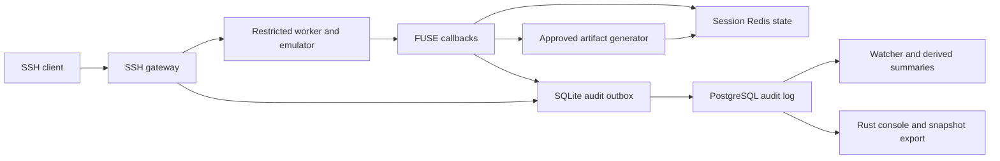

# Mirage architecture and evidence contract

Reviewed 2026-10-11. Current source is distinct from future design extensions. See [scope](RESEARCH_MVP.md), [status](STATUS.md) and [backlog](IMPLEMENTATION_BACKLOG.md).

## Current implementation

`chronos.core.main` initializes state/persistence, starts metrics, watcher and SSH, then mounts FUSE. SSH uses a spawned restricted worker and Python dispatcher, not arbitrary host shell execution. FUSE selects a Redis session namespace using caller PID mappings. Readiness requires actual checks, not printed startup messages.

Redis owns mutable filesystem metadata/content. SQLite admits durable audit events and retries delivery. PostgreSQL holds delivered evidence and derived summaries. No transaction currently spans these stores.

Audit writers acquire a PostgreSQL advisory transaction lock before sequence allocation. Cursor ordering relies on every writer following that protocol. UUIDs deduplicate delivery retries; allocation IDs are not portable global identities. Future ingestion must preserve the invariant or replace it with a proven consumption design.

Default Compose uses an internal network and loopback published ports. That is not a complete containment assessment or an air gap. The trusted core has FUSE-related capabilities and unconfined AppArmor; worker restrictions do not prove core/host isolation.

The inspected workspace also contains an ignored `docker-compose.override.yml` that changes ports/dependencies and adds relays to native Ollama and research services. Thus the base Compose topology is not necessarily the effective local deployment. Record the selected Compose files and inspect merged configuration without exposing credentials; evaluate relay peer-address attribution separately.

Optional inference targets local Ollama. Base Compose starts the deterministic core without Ollama; the inference profile enables model service explicitly. Prepared artifacts are loaded only when the prepared treatment is selected. HTTP and Layer 0 are not established in the startup path, and the core image excludes the deferred Layer 0 and separately built console source. `world_main` publishes a smaller resource-world subset rather than enabling all legacy plugins.

## Extended event envelope — future schema target

The table below includes future distributed/run-context fields. The bounded MVP's implemented command, stage, mutation and lifecycle identities are described in the sections that follow; passing its gates does not imply every extension in this table exists.

| Fields | Meaning |
|---|---|
| `schema_version`, `event_id` | Version and globally unique identity |
| `sensor_id`, `run_id`, `session_id` | Deployment, experiment and observation context |
| `session_sequence` | Admission order with explicit gaps/recovery |
| `command_id`, `stage_id`, `operation_id` | Input, compound-stage and effect correlation |
| `origin` | participant / scripted_test / synthetic / operational / unknown |
| `event_type`, `phase`, `outcome`, `reason` | Submission/start/result and explicit classification |
| `observed_at_utc` | UTC time with clock-quality context |
| `elapsed_seconds` | Monotonic duration with named measurement boundary |
| `payload`, `truncated`, `original_length` | Bounded evidence with transparent truncation |

Existing version 1 is partial. Migrate additively or introduce a new version with explicit mappings; never silently reinterpret historical evidence. Legacy unknowns remain unknown. Raw events are normally immutable; corrections are referenced annotations.

## Command and lifecycle contract

Durably admit an attempt before dispatch. Record protocol request type, working directory, claimed username and effective emulated identity separately. The v1 deception policy is `accept_any_claim_profile_identity`: authentication accepts the observed username, but it never changes the configured profile identity used by the emulated shell. Evidence records both values and a mismatch flag; missing legacy identity remains unknown. Password material is never recorded.

Lifecycle: connection observed → authentication → admitted session (`ssh_session_opened`) → closing → closed (`ssh_disconnect`). The dashboard’s “recorded open” count is the latest durable lifecycle state, not proof that a socket is currently reachable. Recovery may mark a session interrupted with an uncertainty reason; it cannot invent the exact disconnect time. Distinguish rejection, idle timeout, worker timeout, transport failure and operator shutdown.

Outcomes: completed, failed, denied, unsupported, timed_out, interrupted, unknown. Execution kind independently identifies emulation. Status applies to the documented command/stage unit. Timeout does not imply absence of effects.

Generated bytes and bytes accepted by transport writes are separate. Successful complete writing still does not prove client application consumption. Keep bounded output/transcript evidence with length, truncation and access policy; a response byte count does not enable replay.

## Filesystem evidence contract

Cover create/write/truncate/delete, directories and supported metadata changes. Each mutation has intent and result, with errors and before/after revision or digest as applicable. Reads identify bytes/offset actually returned. Origin follows the initiating run. Synthetic events never increase participant metrics.

An audit intent followed by mutation and result still has crash windows. The implementation therefore commits a state-associated mutation journal in the same Redis transaction as every supported effect. A deterministic result-event identity and stable payload make SQLite/PostgreSQL admission idempotent; the journal is acknowledged only after durable local admission, and is replayed at session recovery before cleanup. This reconciles an application crash between effect and result. It is not a distributed transaction and does not protect a Redis transaction that is itself lost under the configured persistence policy or simultaneous storage loss.

Generation uses lease/revision fencing and cannot overwrite participant changes. Kernel caching and open-file semantics require tests against the supported contract.

## Summaries, export and trust

Raw events are authoritative recorded evidence. Summaries are rebuildable projections with processing watermark/schema/rule version. Expose lag and failures. One malformed event needs explicit retry/quarantine handling so missing analysis cannot be mistaken for no activity.

A PostgreSQL snapshot excludes pending outbox records. Export states selection, snapshot, pending counts/watermarks and session closure. `complete.json` means bundle writing finished, not that collection was complete. A complete-session claim requires collection reconciliation.

Use distinct collector writer and console/export read-only roles; configuration support does not itself enforce least privilege. Redacted exports are new artifacts with policy version, omissions, parent reference and hashes. Preserve raw evidence privately. No redaction algorithm can promise perfect removal of arbitrary secrets.

Bound resources and expose capacity before exhaustion. Stop new command admission when durable evidence cannot be recorded; already-started operations may become uncertain. Freeze dependencies, image/configuration and model digests for evaluation. A pinned base image with changing package repositories is not a fully reproducible build.
