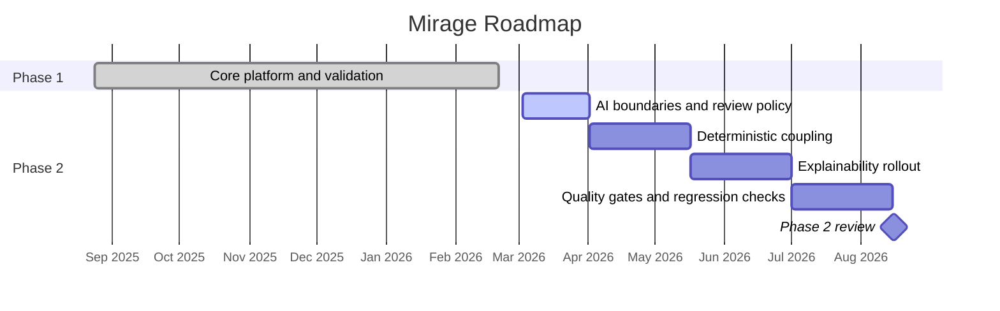

# Mirage Roadmap

This roadmap describes the next phase of work for Mirage, implemented by the Chronos framework in the Apate repository.

## Naming

- Repository codename: Apate
- Product name: Mirage
- Framework name: Chronos

## Program Shape

- Phase 1: Core platform engineering and validation, complete.
- Phase 2: AI integration that improves analyst value without adding unnecessary complexity, in progress.

## Roadmap Intent

The purpose of this document is to keep Phase 2 disciplined. Mirage already has a working core; the remaining work should make it clearer, safer, and more useful, not merely noisier.

## Current Baseline

Repository docs and tests currently show working coverage for:

- Core state management with Redis and Lua
- FUSE-backed filesystem behavior
- SSH and HTTP gateways
- Command analysis, threat signatures, and skill profiling
- Event processing and audit streaming
- Rust-based Layer 0 protocol analysis
- Validation and attack simulation scripts

## Phase 2 Plan

### Workstream 1: AI Boundaries

- Define what AI may do.
- Define what AI must never do.
- Keep state ownership inside deterministic code paths.
- Add review checks for changes that touch AI behavior.

### Workstream 2: Deterministic Coupling

- Preserve atomic state transitions.
- Add fallback behavior when providers are unavailable.
- Test that AI output never becomes the source of filesystem truth.

### Workstream 3: Explainability

- Standardize rationale output for detections and summaries.
- Surface provenance for rule-based vs model-based decisions.
- Keep explanations short enough to be useful and long enough to be defensible.

### Workstream 4: Quality Gates

- Add regression tests for contradiction risks.
- Add checks for repetitive or low-signal AI output.
- Require acceptable precision and utility before rollout.

## Timeline

## Milestones

| Milestone | Target | Acceptance Criteria |
|---|---|---|
| Boundaries frozen | Month 1 | AI responsibilities documented and reviewed |
| Deterministic coupling complete | Months 2-3 | No state mutation through AI-only paths |
| Explainability rollout | Months 3-4 | Analyst-facing rationale available |
| Quality gates enforced | Months 4-5 | AI regression checks in CI |
| Phase 2 review | Month 6 | Release decision with evidence pack |

## Metrics

- State consistency errors: target zero.
- AI fallback reliability: deterministic operation when providers are down.
- Explainability coverage: rationale attached to AI-assisted outputs.
- Regression stability: pass rate of AI-specific checks.
- Noise ratio: fraction of outputs marked low value by operators.

## Future Tracks

After Phase 2, the likely next steps are operational hardening, deeper detection logic, and broader platform integration.

- Operational hardening: SLOs, canary updates, retention policy.
- Intelligence expansion: behavioral sequence modeling and campaign clustering.
- Integrations: SIEM export, incident timelines, orchestration handoff.
- Scale: multi-instance coordination and cost-aware deployment profiles.
